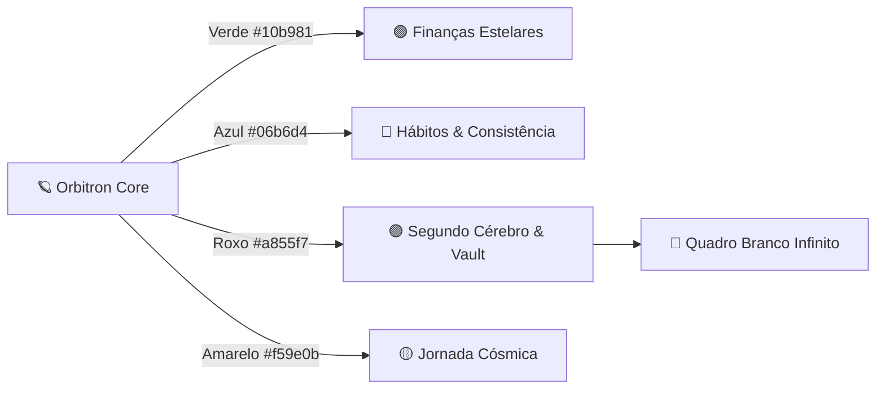

<div align="center">

  

  # 🪐 ORBITRON
  
  ### **O Sistema Operacional Pessoal Espacial 100% Local-First & Open Source**
  
  *Finanças Estelares • Hábitos com IA Offline • Segundo Cérebro em Markdown • Quadro Branco Infinito • Jornada Cósmica*

  <p align="center">
    <a href="https://github.com/SamuelFonsecaUp/orbitron/releases"></a>
    <a href="https://opensource.org/licenses/MIT"></a>
    <a href="https://github.com/SamuelFonsecaUp/orbitron"></a>
    <a href="https://jsoncanvas.org"></a>
    <a href="https://electronjs.org"></a>
    <a href="https://react.dev"></a>
    <a href="https://github.com/SamuelFonsecaUp/orbitron/pulls"></a>
  </p>

  <p align="center">
    <a href="#-manifesto-por-que-o-orbitron-existe">Manifesto</a> •
    <a href="#-comparativo-orbitron-vs-outros">Comparativo</a> •
    <a href="#-os-4-pilares-estelares">Módulos</a> •
    <a href="#-quadro-branco-infinito-canvas">Quadro Branco</a> •
    <a href="#-backup-universal-orbit">Arquivo .orbit</a> •
    <a href="#-começando-instalação-e-execução-local">Começando</a> •
    <a href="#-arquitetura-do-sistema">Arquitetura</a>
  </p>

</div>

---

## 🌟 Manifesto: Por que o Orbitron existe?

A maioria dos softwares de produtividade modernos colocam seus dados mais sensíveis — seus gastos financeiros, suas metas, seus pensamentos e suas anotações mais íntimas — em servidores corporativos remotos, sujeitos a assinaturas mensais recorrentes, vazamentos e bloqueios unilaterais de acesso.

O **Orbitron** foi forjado sobre um princípio inegociável: **Soberania Absoluta dos seus Dados**.

1. **🔒 100% Local-First & Offline**: O banco de dados SQLite (em modo WAL de alta performance) e seus arquivos Markdown residem exclusivamente no seu disco local.
2. **🚫 Zero Telemetria & Zero Rede**: Sem rastreadores, sem envio de métricas para analytics, sem chamadas externas ocultas. Seu computador é o seu castelo.
3. **📦 Pacote Universal Portátil (`.orbit`)**: Todo o seu ecossistema pessoal é empacotado com integridade ACID em um único arquivo que você pode transportar no pendrive e restaurar em qualquer máquina em milissegundos.
4. **📄 Formatos Abertos (Markdown & JSON Canvas 1.0)**: Suas notas e quadros brancos são compatíveis nativamente com Obsidian, VS Code e editores de texto padrão. Sem lock-in proprietário.
5. **✨ Open Source sob Licença MIT**: Código 100% auditável, livre e aberto para sempre.

---

## ⚡ Comparativo: Orbitron vs Outros

| Capacidade | 🪐 Orbitron | 📝 Notion | 🧠 Obsidian | 🎨 Miro / FigJam |
| :--- | :---: | :---: | :---: | :---: |
| **Armazenamento** | **100% Local no seu Disco** | Servidor em Nuvem | Local no Disco | Servidor em Nuvem |
| **Modelo de Acesso** | **Livre & Open Source (MIT)** | Assinatura Mensal | Grátis / Sync Pago | Assinatura Mensal |
| **Finanças & Orçamentos** | **Nativo (OFX, Cartões, IA)** | Requer templates manuais | Não possui | Não possui |
| **Hábitos com IA Local** | **Nativo (Heatmap 365d)** | Tabelas manuais | Requer plugins de terceiros | Não possui |
| **Quadro Branco Infinito** | **Lucidspark + JSON Canvas** | Não possui | Canvas básico | Limite de 3 quadros |
| **Arrasta e Solta Fluido** | **Nativo (Toolbar + Sidebar + Desktop)** | Básico | Básico | Fluido |
| **Backup Portátil Universal** | **1 Arquivo `.orbit`** | Vários arquivos soltos | Pastas dispersas | Não possui |
| **Telemetria de Rede** | **Zero (Comprovado no código)** | Rastreamento ativo | Telemetria opcional | Rastreamento ativo |

---

## 🌌 A Estética Espacial & Os 4 Ambientes Planetários

Ao inicializar o sistema, o símbolo orbital do **Orbitron** desperta através de uma sequência de inicialização estelar suave que percorre as quatro frequências espectrais. Conforme você navega entre as áreas, a interface responde dinamicamente com iluminação harmônica e transições orbitais:



---

## 🪐 Os 4 Pilares Estelares

### 🟢 1. Finanças Estelares (`#10b981`)
- **Contas & Carteiras Multimoeda**: Gestão de contas correntes, contas de investimento, poupança e dinheiro físico.
- **Cartões de Crédito Inteligentes**: Fechamento de fatura, data de vencimento, limite comprometido e projeção automática de compras parceladas para meses futuros.
- **Importador Universal OFX & CSV**: Suporte nativo a extratos bancários de bancos brasileiros (Nubank, Itaú, Bradesco, Santander, Inter, C6, etc.).
- **Categorização Automática com Aprendizado Local**: O sistema memoriza e classifica lançamentos recorrentes automaticamente sem enviar nenhum dado para a internet.
- **Reserva de Emergência & Cobertura**: Calcula em tempo real quantos meses do seu custo de vida atual sua reserva financeira é capaz de cobrir.
- **Previsão de Fluxo de Caixa**: Gráficos com saldo projetado e alerta inteligente de contas a pagar.

---

### 🔵 2. Hábitos & Consistência com IA Offline (`#06b6d4`)
- **Check-in Retroativo Flexível**: Esqueceu de registrar ontem? Navegue pelo calendário e marque seus hábitos retroativamente a qualquer momento.
- **Mapa de Calor Anual (Heatmap de 365 Dias)**: Visualização matricial estilo GitHub onde cada dia do ano pode ser alternado com um único clique.
- **Métricas e Inteligência Preditiva 100% Local**:
  - **Score de Consistência (0 a 100%)**: Análise ponderada com detecção de ritmo (Acelerando, Estável ou Em declínio).
  - **Prevenção de Quebra de Sequência**: Alertas inteligentes com sugestão de micro-hábitos (regra dos 2 minutos).
  - **Padrão Semanal de Foco**: Identifica estatisticamente os dias de maior rendimento e os momentos propensos à procrastinação.
  - **Efeito Dominó (Habit Stacking)**: Algoritmo de probabilidade condicional que descobre quais hábitos, quando concluídos, impulsionam a realização de outros.

---

### 🟣 3. Segundo Cérebro & Vault Markdown (`#a855f7`)
- **Editor de Blocos com Comando `/` (Slash Commands)**: Menu flutuante acionado por teclado com navegação completa por setas e auto-scroll.
- **Exportação Nativa para PDF**: Exporte relatórios, atas de reunião ou documentos para PDFs com formatação editorial profissional via Electron IPC nativo.
- **Arquivos Markdown Puros em Disco (`.md`)**: Cada nota criada é um arquivo físico na pasta do cofre, pronto para ser lido no Obsidian, VS Code ou qualquer editor.
- **Ambientes de Trabalho & Pastas Hierárquicas**: Organize seu universo em múltiplos ambientes (Pessoal, Trabalho, Estudos) e pastas ilimitadas.
- **Busca Global Instantânea com SQLite FTS5**: Encontra palavras-chave instantaneamente em notas Markdown e em notas adesivas de quadros brancos com tolerância a acentos em português.

---

### 🎨 Quadro Branco Infinito (Canvas Estilo Lucidspark)
Novo motor de canvas infinito desenvolvido do zero com liberdade total de posicionamento e conectores:

- **Arrasta e Solta Completo (Drag & Drop)**:
  - Arraste notas adesivas (post-its), formas geométricas, caixas de texto e quadros delimitadores direto da barra superior e solte no canvas.
  - Puxe notas Markdown diretamente da barra lateral do Vault e solte-as no quadro como cartões interativos.
  - Arraste imagens do seu computador para o quadro para anexá-las imediatamente.
- **Conectores Livres com Hotspots Magnéticos**:
  - Cada elemento possui 4 âncoras magnéticas (top, right, bottom, left). Ao passar o mouse, basta arrastar de qualquer lado para puxar uma **seta elástica animada** em direção a outro nó.
  - Suporte a conexões ortogonais com cantos arredondados, curvas Bézier suaves e retas diretas.
- **Motor SVG a 60 FPS com Transformações Efêmeras**:
  - Movimento, redimensionamento com vértices fixos em qualquer ângulo (0° a 360°) e rotação em tempo real com resposta imediata.
- **Formato Canônico Aberto JSON Canvas 1.0**:
  - Seus quadros são salvos como arquivos `.canvas` na pasta `Quadros/`, 100% compatíveis com o Obsidian Canvas.
- **Ferramentas Inclusas**:
  - Post-its com paleta Lucidspark vibrante, Formas (Retângulo, Círculo, Losango, Triângulo), Desenho Livre (Caneta), Texto, Minimapa Interativo, Zoom de 10% a 400%, Controles de Alinhamento Magnético e Exportação em Imagem PNG nativa.

---

### 🟡 4. Jornada Cósmica & Gamificação RPG (`#f59e0b`)
- **Fundo do Sistema Solar em Tempo Real**: Cenário espacial animado com o Sol em atividade estelar e os planetas orbitando com física suave ao fundo (incluindo os anéis de Saturno).
- **Gamificação Integrada**: Cada lançamento categorizado, hábito concluído ou meta financeira atingida concede pontos de experiência (XP) ao seu perfil.
- **Níveis de Consciência Cósmica**: Suba de patente estelar e desbloqueie novas conquistas.
- **Missões Semanais & Árvore de Conquistas**: Conquistas categorizadas por raridade (Comum, Rara, Épica e Lendária).

---

## 📦 Backup Universal (.orbit)

Diga adeus à perda de dados ao formatar o computador ou trocar de máquina. Com o **Orbitron**, você exporta e restaura um arquivo universal único:

```
backup_universo_2026.orbit
```

### O que vem dentro do pacote `.orbit`?
- 💼 **Finanças**: Todas as contas, cartões, lançamentos, orçamentos, regras de aprendizado e metas.
- 🎯 **Hábitos**: Histórico completo de check-ins de 365 dias, sequências e métricas estatísticas.
- 🧠 **Segundo Cérebro**: Todas as pastas, notas Markdown, anexos de imagem e quadros brancos `.canvas`.
- 🚀 **Jornada Cósmica**: Nível de XP, histórico de missões e conquistas desbloqueadas.

### Como migrar em 3 passos:
1. Abra **Configurações ➔ Dados & Backup** e clique em **Exportar Arquivo Orbitron (.orbit)**.
2. Salve o arquivo no seu pendrive ou disco seguro.
3. No novo computador, abra o Orbitron e clique em **Restaurar Backup (.orbit)**. O banco de dados SQLite e os arquivos em disco são restaurados instantaneamente com integridade transacional ACID.

---

## 🏗️ Arquitetura do Sistema

```
orbitron/
├── electron/                 # Backend Desktop (Node.js + Electron CJS)
│   ├── main.cjs              # Processo principal, ciclo de vida e IPC handlers
│   ├── services.cjs          # Serviços SQLite WAL, regras financeiras, exportação .orbit
│   ├── vaultService.cjs      # Gerenciamento de arquivos Markdown e árvore do Vault
│   ├── canvasService.cjs     # CRUD atômico de arquivos .canvas e sincronização FTS5
│   ├── canvasExport.cjs      # Exportador nativo de imagens PNG/SVG com diálogo do SO
│   └── preload.cjs           # Context Bridge seguro (isolamento de contexto e segurança)
├── src/                      # Frontend SPA (React 19 + TypeScript Estrito + Vite)
│   ├── components/           # Componentes atômicos reutilizáveis (< 250 linhas cada)
│   │   ├── OrbitLogo.tsx     # Logotipo orbital oficial animado nas 4 frequências de cores
│   │   └── OrbitBootActivation.tsx # Sequência cósmica de inicialização
│   ├── modules/              # Módulos desacoplados
│   │   ├── canvas/           # Quadro Branco Infinito (Motor SVG, JSON Canvas 1.0, 60fps)
│   │   │   ├── scene/        # Geometria, câmera, transformações, conectores e snapping
│   │   │   ├── render/       # Camadas SVG (Grid, Nós, Arestas, Seleção)
│   │   │   ├── store/        # Gerenciamento useSyncExternalStore + histórico Undo/Redo
│   │   │   └── ui/           # Toolbar Lucidspark, PropertyPanel, MiniMap e controles
│   │   ├── habits/           # Páginas de hábitos, heatmap 365d, motor de consistência
│   │   ├── vault/            # Segundo cérebro, editor slash, exportador PDF, markdown
│   │   └── journey/          # Sistema solar animado, missões semanais e conquistas RPG
│   └── views/                # Telas do aplicativo (Dashboard, Lançamentos, etc.)
└── tests/                    # Suíte com mais de 114 testes automatizados com Vitest
```

---

## 🛠️ Começando: Instalação e Execução Local

### Pré-requisitos
- [Node.js](https://nodejs.org/) versão 18 ou superior (LTS recomendada).
- [Git](https://git-scm.com/) instalado no seu sistema.

### 1. Clonar o Repositório
```bash
git clone https://github.com/SamuelFonsecaUp/orbitron.git
cd orbitron
```

### 2. Instalar as Dependências
```bash
npm install
```

### 3. Executar em Modo de Desenvolvimento
```bash
npm run dev
```
O aplicativo compilará com o Vite e inicializará a janela do Electron com Hot Module Replacement (HMR) ativo.

### 4. Executar os Testes Automatizados
```bash
npm test
```
Executa a suíte de 114 testes unitários e de integração no Vitest.

### 5. Compilar o Instalador para Windows (.exe)
```bash
npm run dist
```
Gera o instalador NSIS completo e o executável portátil na pasta `release/`.

---

## ⌨️ Atalhos de Teclado Globais

| Atalho | Ação |
| :--- | :--- |
| `Ctrl + K` / `Ctrl + P` | Abrir Paleta de Comandos & Busca Rápida |
| `Ctrl + N` | Criar Nova Nota no ambiente ativo |
| `Ctrl + \` | Alternar exibição da barra lateral |
| `Ctrl + /` ou `F1` | Abrir Guia de Ajuda e Atalhos |
| `Alt + P` | Modo Privacidade (Oculta todos os valores em R$) |
| **No Quadro Branco** | |
| `V` / `H` | Ferramenta de Seleção / Mão para Pan |
| `S` / `T` | Nova Nota Adesiva (Sticky) / Texto Livre |
| `C` / `P` | Conector / Caneta de Desenho Livre |
| `Ctrl + D` | Duplicar elementos selecionados |
| `Delete` / `Backspace` | Excluir elementos selecionados |
| `Ctrl + Z` / `Ctrl + Y` | Desfazer / Refazer |
| `Scroll do Mouse` | Pan vertical/horizontal (segurar `Ctrl` para Zoom) |

---

## 🤝 Como Contribuir para o Projeto

O Orbitron é um projeto **Open Source** e encoraja contribuições da comunidade mundial! Seja para corrigir uma falha, sugerir novos formatos de extrato bancário, expandir a inteligência de hábitos ou refinar a estética:

1. **Faça um Fork** do projeto no GitHub: [github.com/SamuelFonsecaUp/orbitron](https://github.com/SamuelFonsecaUp/orbitron).
2. **Crie uma Branch de Funcionalidade**:
   ```bash
   git checkout -b feat/minha-melhoria-espacial
   ```
3. **Respeite a Regra de Ouro**:
   - Cada componente ou arquivo de lógica deve permanecer **estritamente abaixo de 250 linhas**. Caso cresça, decomponha em submódulos ou componentes atômicos antes de enviar.
4. **Verifique os Testes**:
   ```bash
   npm test
   ```
5. **Faça o Commit das suas mudanças**:
   ```bash
   git commit -m "feat(canvas): adicionar suporte a templates rápidos"
   ```
6. **Abra um Pull Request** detalhando as melhorias!

---

## 🔒 Privacidade e Segurança Local

- **Zero Chamadas a Nuvem Externa**: Todas as operações de leitura, escrita e inteligência acontecem exclusivamente na memória e no disco local da sua máquina.
- **Modo Privacidade Instantâneo (Alt + P)**: Um clique no ícone de "Olho Mágico" oculta todos os valores financeiros em R$, ideal para apresentações e gravações.
- **Proteção por PIN Local**: Opção de travar o aplicativo ao inicializar com PIN criptografado localmente.
- **Exportação Limpa**: Seus arquivos Markdown e Canvas permanecem em formato padrão sem proprietarização.

---

## 📄 Licença

Este projeto é distribuído sob a licença **MIT** — consulte o arquivo [LICENSE](LICENSE) para obter mais detalhes. Você é livre para estudar, modificar, distribuir e usar em seus projetos pessoais ou comerciais.

---

<div align="center">
  <sub>Construído com ❤️ pela comunidade Open Source • Soberania digital para a sua vida pessoal.</sub>
</div>
