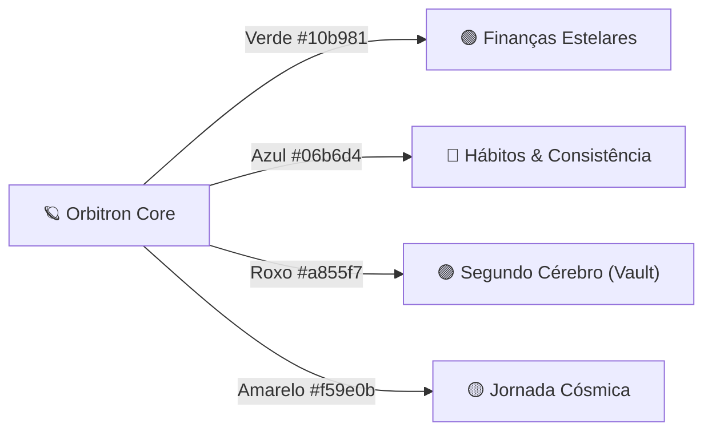

<div align="center">

  

  # 🪐 ORBITRON
  
  ### **O Sistema Operacional Pessoal Espacial 100% Local-First & Open Source**
  
  *Finanças Estelares • Hábitos & Consistência com IA Offline • Segundo Cérebro em Markdown com Exportação PDF • Jornada Cósmica*

  <p align="center">
    <a href="https://opensource.org/licenses/MIT"></a>
    <a href="https://github.com/SamuelFonsecaUp/pigo-financas"></a>
    <a href="https://github.com/SamuelFonsecaUp/pigo-financas/pulls"></a>
    <a href="https://github.com/SamuelFonsecaUp/pigo-financas"></a>
    <a href="https://electronjs.org"></a>
    <a href="https://react.dev"></a>
  </p>

</div>

---

## 🌟 Manifesto: Por que o Orbitron existe?

A maioria dos softwares de produtividade modernos colocam seus dados mais sensíveis — seus gastos financeiros, suas metas, seus pensamentos e suas anotações mais íntimas — em servidores corporativos remotos, sujeitos a assinaturas mensais, vazamentos e bloqueios de acesso.

O **Orbitron** foi criado com um princípio inegociável: **Soberania Absoluta dos Dados**.
1. **100% Local-First**: O banco de dados SQLite (WAL) e seus arquivos Markdown residem exclusivamente no seu computador.
2. **Zero Telemetria**: Sem rastreadores, sem envio de métricas, sem conexão oculta.
3. **Backup Universal Portátil (`.orbit`)**: Todo o seu universo pessoal (finanças, hábitos, notas, jornada) é empacotado em um único arquivo final portátil que você pode salvar em um pendrive e restaurar em qualquer máquina em milissegundos.
4. **Open Source sob licença MIT**: Código auditável, extensível e livre para sempre pela comunidade.

---

## 🌌 A Estética Espacial & Os 4 Ambientes Planetários

Ao iniciar o aplicativo, o símbolo orbital do **Orbitron** é ativado em uma sequência de inicialização estelar transitando pelas quatro frequências espectrais do sistema. Conforme você troca de tela, o logotipo e a interface reagem dinamicamente com animação orbital 360° e mudança harmônica de iluminação:



---

### 🟢 1. Finanças Estelares (`#10b981`)
- **Contas & Carteiras Multimoeda**: Gestão de contas correntes, contas de investimento, poupança e dinheiro em espécie.
- **Cartões de Crédito Inteligentes**: Fechamento de fatura, vencimento, limite comprometido e projeção automática de compras parceladas para meses futuros.
- **Importador Universal OFX & CSV**: Suporte nativo a extratos bancários de bancos brasileiros (Nubank, Itaú, Bradesco, Santander, Inter, C6, etc.).
- **Motor de Aprendizado Local de Categorização**: O sistema aprende os estabelecimentos importados e categoriza lançamentos recorrentes automaticamente sem sair da sua máquina.
- **Reserva de Emergência & Cobertura**: Calcula em tempo real quantos meses do seu custo de vida atual sua reserva financeira é capaz de sustentar.
- **Previsão de Fluxo de Caixa**: Gráficos e relatórios com saldo projetado e alerta de contas a pagar.

---

### 🔵 2. Hábitos & Consistência com IA Offline (`#06b6d4`)
- **Check-in Retroativo Flexível**: Esqueceu de marcar ontem ou anteontem? Navegue por datas anteriores ou abra o calendário para registrar hábitos retroativamente a qualquer momento.
- **Mapa de Calor Anual (Heatmap 365 Dias)**: Visualização matricial estilo GitHub onde cada célula do ano pode ser alternada com um único clique.
- **Métricas e Inteligência Preditiva 100% Local**:
  - **Score de Consistência (0 a 100%)**: Análise ponderada com detecção de momento (Acelerando, Estável ou Em declínio).
  - **Prevenção de Quebra de Sequência (Streak Drops)**: Alertas inteligentes com sugestão de micro-hábitos (regra dos 2 minutos).
  - **Padrão Semanal de Foco**: Identifica estatisticamente os dias de maior foco e os dias com maior taxa de procrastinação.
  - **Efeito Dominó (Habit Stacking)**: Algoritmo de probabilidade condicional que descobre quais hábitos quando completados disparam a conclusão de outros.

---

### 🟣 3. Segundo Cérebro & Vault com Exportação PDF (`#a855f7`)
- **Editor de Blocos com Comando `/` (Slash Commands)**: Menu flutuante acionado por teclado com navegação completa por setas (cima/baixo), auto-scroll inteligente e seleção com `Enter`.
- **Exportação Nativa para PDF**: Exporte qualquer documento, ata de reunião ou anotação para um PDF formatado com tipografia editorial limpa através do Electron IPC nativo.
- **Arquivos Markdown Reais (`.md`)**: Cada página criada é um arquivo Markdown legível no seu disco rígido, compatível com Obsidian, VS Code ou qualquer editor de texto.
- **Ambientes de Trabalho & Pastas Aninhadas**: Organize suas notas por pastas, tags e coleções personalizadas.
- **Mapas Mentais Visuais**: Crie grafos e diagramas de pensamento livre com nós, conexões e cores espaciais.
- **Cofre Criptografado de Credenciais**: Armazene dados e segredos com criptografia local segura.

---

### 🟡 4. Jornada Cósmica & Gamificação RPG (`#f59e0b`)
- **Fundo do Sistema Solar em Tempo Real**: Cenário cósmico animado com o Sol em atividade estelar e os planetas do sistema solar em órbitas físicas suaves ao fundo (incluindo os anéis de Saturno).
- **Gamificação Integrada**: Cada transação categorizada, hábito concluído ou meta financeira atingida concede pontos de experiência (XP) ao seu perfil.
- **Níveis de Consciência Financeira**: Suba de nível e desbloqueie novas patentes cósmicas.
- **Missões Semanais & Árvore de Conquistas**: Conquistas classificadas por raridade (Comum, Rara, Épica e Lendária).

---

## 📦 Arquivo Universal Final Orbitron (`.orbit`)

Chega de perder seus dados ao trocar de computador ou depender de sincronizações em nuvem lentas e instáveis.

Com o **Orbitron**, você exporta e restaura um arquivo universal único:

```
orbit_backup_2026-10-24.orbit
```

### O que está empacotado dentro do arquivo `.orbit`?
- 💼 **Finanças**: Todas as contas, cartões, lançamentos, orçamentos, regras de importação e metas.
- 🎯 **Hábitos**: Histórico de check-ins de todos os dias, sequências atuais e passadas, notas de hábitos e inteligência preditiva.
- 🧠 **Segundo Cérebro**: Todas as páginas, pastas, documentos Markdown e mapas mentais completos.
- 🚀 **Jornada Cósmica**: Nível de XP, missões concluídas e histórico de conquistas.

### Como migrar entre máquinas:
1. No seu computador atual, abra **Configurações ➔ Dados & Arquivo Final Orbitron** e clique em **Exportar Arquivo Orbitron (.orbit)**.
2. Salve o arquivo no seu pendrive ou disco seguro.
3. No novo computador, abra o Orbitron (mesmo na tela inicial de boas-vindas) e clique em **Restaurar Backup (.orbit)**.
4. Pronto! O banco de dados local SQLite e o cofre de documentos restauram tudo com integridade transacional ACID.

---

## 🏗️ Arquitetura do Sistema

```
orbitron/
├── electron/                 # Backend Desktop (Node.js + Electron CJS)
│   ├── main.cjs              # Processo principal, janelas, ciclo de vida e IPC handlers
│   ├── services.cjs          # Serviços SQLite WAL, regras financeiras, exportação .orbit
│   ├── vaultService.cjs      # Gerenciamento de arquivos Markdown em disco e exportação
│   └── preload.cjs           # Context Bridge seguro (isolamento de contexto e segurança)
├── src/                      # Frontend SPA (React 19 + TypeScript + Vite)
│   ├── components/           # Componentes atômicos reutilizáveis (< 250 linhas cada)
│   │   ├── OrbitLogo.tsx     # Símbolo vetorial oficial animado com suporte aos 4 módulos
│   │   └── OrbitBootActivation.tsx # Sequência cósmica de boot
│   ├── context/              # Contextos globais (FinancialContext, HabitsContext)
│   ├── modules/              # Módulos desacoplados
│   │   ├── habits/           # Páginas de hábitos, heatmap 365d, motor de consistência
│   │   ├── vault/            # Segundo cérebro, editor slash, exportador PDF, markdown
│   │   └── journey/          # Sistema solar animado, missões semanais e conquistas RPG
│   └── views/                # Telas do aplicativo (Dashboard, Lançamentos, etc.)
└── tests/                    # Suíte de testes automatizados com Vitest
```

---

## 🛠️ Começando: Instalação e Execução Local

### Pré-requisitos
- [Node.js](https://nodejs.org/) versão 18 ou superior (LTS recomendada).
- [Git](https://git-scm.com/) instalado no seu sistema.

### 1. Clonar o Repositório
```bash
git clone https://github.com/SamuelFonsecaUp/pigo-financas.git
cd pigo-financas
```

### 2. Instalar as Dependências
```bash
npm install
```

### 3. Rodar em Modo de Desenvolvimento (Vite + Electron HMR)
```bash
npm run dev
```
O aplicativo compilará o React com Vite instantâneo e abrirá a janela do Electron com Hot Module Replacement ativado.

### 4. Executar os Testes Automatizados
```bash
npm test
```
Executa a suíte de testes unitários e de integração com Vitest.

### 5. Compilar o Instalador Executável para Windows (.exe)
```bash
npm run dist
```
Gera o instalador NSIS completo e o executável portátil na pasta `release/`.

---

## 🤝 Como Contribuir para o Projeto

O Orbitron é um projeto **Open Source** e encoraja contribuições da comunidade mundial! Seja para corrigir um bug, sugerir um novo formato de extrato bancário, melhorar a inteligência de hábitos ou refinar a estética espacial:

### Diretrizes de Contribuição:
1. **Faça um Fork** do projeto no GitHub.
2. **Crie uma Branch de Funcionalidade**:
   ```bash
   git checkout -b feat/minha-melhoria-espacial
   ```
3. **Respeite a Regra de Tamanho de Arquivo**:
   - Cada componente ou arquivo de lógica deve permanecer **estritamente abaixo de 250 linhas**. Caso um componente cresça, desmembre-o em submódulos ou componentes atômicos.
4. **Adicione Testes**: Garanta que `npm test` execute com 100% de sucesso.
5. **Faça o Commit das suas mudanças**:
   ```bash
   git commit -m "feat(habits): adicionar filtro por período no heatmap"
   ```
6. **Abra um Pull Request** detalhando as motivações e screenshots das telas afetadas!

---

## 🔒 Privacidade e Segurança

- **Zero Chamadas a Nuvem Externa**: Todas as operações de leitura, escrita e inteligência acontecem na memória e no disco local da máquina.
- **Modo Privacidade Instantâneo (Alt + P)**: Um clique no ícone de "Olho Mágico" oculta todos os valores em R$ da tela, ideal para usar em cafés, coworkings ou gravações.
- **Proteção por PIN Local**: Opção de travar o aplicativo ao inicializar com PIN criptografado localmente.
- **Exportação Limpa**: Seus arquivos Markdown permanecem em formato padrão legível sem proprietarização.

---

## 📄 Licença

Este projeto é distribuído sob a licença **MIT** — consulte o arquivo [LICENSE](LICENSE) para obter mais detalhes. Você é livre para estudar, modificar, distribuir e usar em seus projetos pessoais ou comerciais.

---

<div align="center">
  <sub>Construído com ❤️ pela comunidade Open Source • Soberania digital para a sua vida pessoal.</sub>
</div>
